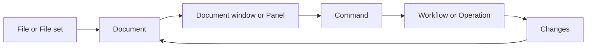
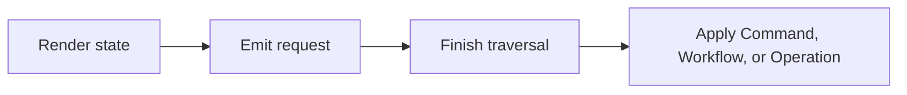

# GUI Architecture

This page defines the GUI ownership model. The [architecture layers](layers.md)
document defines project-wide components and dependencies. Use the [project
glossary](../glossary.md) for standard terms.

## Scope

The GUI presents and edits UO data through the headless `gui_model` component.
It does not own MUL library logic, *File* identity, or domain invariants.

## Boundaries

A *File* or *File set* enters the GUI boundary. A *File set* identifies related
*Files* and their semantic roles. A *Document* owns the identity, lifecycle, and
editing state of a *File* or *File set*.
*Changes* own unsaved data. *View state* owns selection, navigation, and display
state.

GUI surfaces present state and emit requests. They do not own *File* paths,
readers, profile fallback, *Document* identity, save policy, or mutations.

## Ownership

- The `gui_model` component is headless. It owns *Documents*, *File sets*,
  *Changes*, *View state*, profiles, providers, persistence, lifecycle contracts,
  and typed *Operations*.
- The `gui` component owns workbench composition, presentation, GUI surfaces, menus,
  workflows, themes, icons, and layout. It translates interaction into model
  requests and uses adapters and contracts.
- The `uomul` component remains a standalone MUL library. Format logic stays out
  of the GUI and the GUI model.

## GUI surfaces

- *Document window*: A dockable surface for exactly one open *Document*. It
  presents the document and its *View state*. Example: a Map document window.
- *Panel*: An auxiliary dock surface for shared content. It may present an
  inspector, tool controls, or logs. It does not own a *Document* lifecycle.
  Example: the Tile Inspector or Logs panel.
- *Canvas*: An interactive content region inside a *Document window* or *Panel*.
  It renders visual or spatial data and emits interaction requests. Example: a
  Map canvas.
- *Dialog*: A transient surface that requests input or a decision and returns a
  result. It does not become a second *Document* model. Example: an Open Map
  dialog.
- *Menu Bar*: A persistent top-level region that presents application
  *Commands*. Example: File, Edit, View, and Windows menus.
- *Status Bar*: A fixed workbench region that presents status, diagnostics, and
  context. Example: *Dirty* state and the hovered tile.

## Documents and providers

- *File* or *File set*: A *File set* preserves semantic roles, canonical paths,
  qualifiers, validation, and capabilities. Neither owns GUI state.
- *Documents*: Expose identity, validation, lifecycle state, and *Dirty* state.
  A failed *Save* keeps the *Document* open and *Dirty* with its *Changes*
  available for retry or *Discard*.
- *Changes*: Contain unsaved data.
- *View state*: Contains selection, navigation, and display state.
- Profiles: Provide default metadata sources.
- Providers: Expose effective read models, *File* identity, status, and revision.
  They do not choose *Files* from a *Document window* or *Panel*.
- Metadata *Documents*: Use the normal lifecycle. Their providers update when the
  *Document* revision changes. An unavailable or invalid source remains visible
  with diagnostics, and dependent tools are disabled rather than silently using
  another source.

## Commands, Workflows and Operations

- *Command*: A discrete user request. Surfaces, menus, and tools use the same
  *Command* contracts. *Commands* have stable IDs, availability, and disabled
  reasons.
- *Workflow*: Coordinates a multi-step transition.
- *Operation*: Validates and applies a domain mutation. It preserves the prior
  state when validation or execution fails, and its result updates *Changes*.

## Render safety

Rendering uses this sequence:

Rendering code reads state and emits requests. After traversal, the workbench applies
*Commands*, *Workflows*, and *Operations*. This sequence keeps *File* writes,
profile changes, *Document* closes, and collection erasure outside rendering.

## Persistence

- Identifiers: Persist *Document* kinds, *Document window* IDs, *Command* IDs,
  tool IDs, *Panel* keys, *File* roles, and asset namespaces.
- Migrations: Changing a persisted identifier requires a schema migration.
- State lifetimes: Keep layout, *Changes*, *View state*, preferences, and asset
  state separate when their lifetimes differ.
