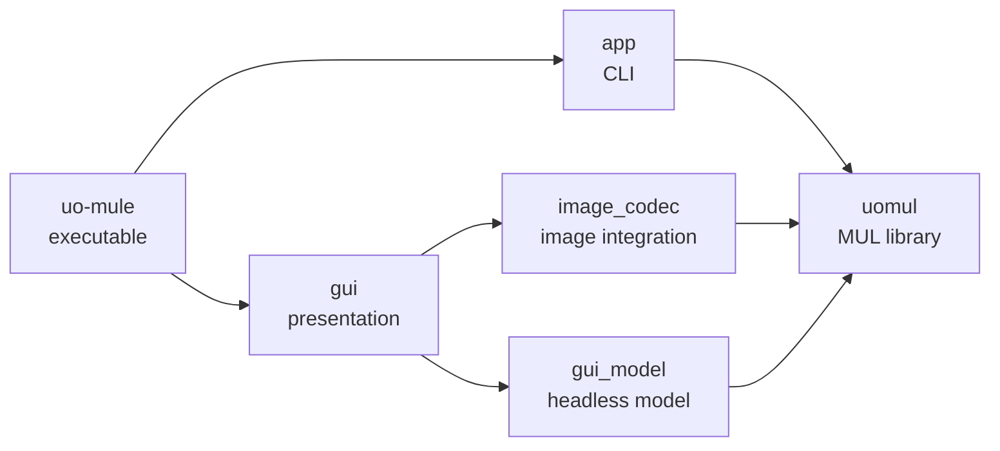

# Architecture Layers and Ownership

This page maps the main project layers. It also shows where new code belongs.

## Top-level components

## uomul

`uomul` is a standalone UO MUL library for reading and editing MUL *files*. It has
no dependencies on application code.

## app

The `app` component adapts the library to CLI *Commands*. It parses arguments,
dispatches *Commands*, and reports CLI diagnostics. It does not implement formats.

The `core` component contains shared application primitives. The `logger`
component contains logging.

## image_codec

The `image_codec` component provides BMP and PNG decoding and encoding. It uses
the single-header [stb](https://github.com/nothings/stb) library through
`stb_image.h` and `stb_image_write.h`. The dependency is pinned in the build
configuration. `image_codec` depends on `uomul` and `options`. It does not
replace the `uomul` library.

## gui_model

The `gui_model` component is the headless application model. It manages
*Documents*, profiles, providers, lifecycle, persistence, and typed *Operations*. It
exposes model snapshots to the GUI and works without a display or ImGui context.

## gui

The `gui` component uses [Dear ImGui](https://github.com/ocornut/imgui) for
immediate-mode rendering. Dear ImGui is vendored and pinned through
`cmake/GuiDependencies.cmake`. Its backends use
[GLFW](https://github.com/glfw/glfw) for windows and input and OpenGL for
rendering. The GUI also loads the [Material Design Icons](https://github.com/Templarian/MaterialDesign-Webfont)
font as an application asset. It owns frame composition and runtime setup. It
presents *Document windows*, *Panels*, *Canvases*, and *Dialogs*. It provides
presentation helpers, *Commands*, menus, workflows, strings, icons, themes, and
layout. It translates user interaction into model requests.

Presentation code uses adapters and contracts.

## uo-mule

The executable composes `app` and `gui`.

## Ownership and dependencies

State is assigned to its owning component:

| Example | Owner |
| --- | --- |
| CLI commands | `app` |
| Multi-step transitions | `gui` |
| Transient interaction | `gui` |
| Dock layout | `gui_model` |
| Domain mutations | `gui_model` |
| Effective profile data | `gui_model` |
| *File* identity and validation | `gui_model` |
| Unsaved *File* data | `gui_model` |
| User preferences | `gui_model` |
| BMP and PNG image integration | `image_codec` |
| Executable composition | `uo-mule` |
| Binary format logic | `uomul` |
