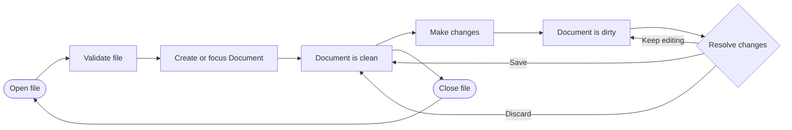
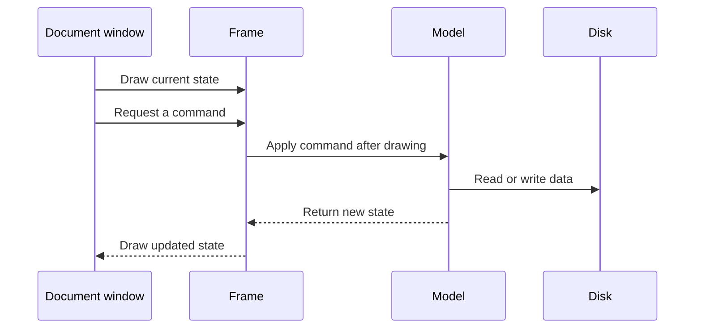

# File and Document Lifecycle

This page explains how a *file* becomes an open *Document*, how *Changes* make
the *Document* *Dirty*, and how *Save*, *Discard*, and close complete the cycle.

## Lifecycle cycle

A clean *Document* represents its saved *file* or *file set*. Making a change
creates *Changes* and makes the *Document* *Dirty*. *Save* or *Discard* returns
it to a clean state. A *Dirty* *Document* must resolve its *Changes* before it can
close. Closing the *file* releases the *Document* and returns the lifecycle to
Open *file*.

## Opening a file

Opening a *file* or *file set* has four steps:

1. **Choose the *file*.** The user selects a *file* or a related *file set*.
2. **Validate the *file*.** The application checks structure, required
   companions, dimensions, and other format rules.
3. **Create or focus the *Document*.** A valid canonical identity opens once.
   An already-open identity focuses its existing *Document*.
4. **Start clean.** The *Document* represents the saved data and has no
   *Changes*.

Invalid input produces diagnostics and does not create a usable *Document*.

## Clean and Dirty Documents

The clean state means that the *Document* has no unsaved *Changes*. The *Dirty*
state means that *Changes* differ from the saved *file* data.

*Changes* belong to the *Document*. They remain available while the *Document*
is open, including after a failed *Save*. *View state* such as selection,
navigation, and display state is separate from *Changes*.

*Save* and *Discard* have different results:

- *Save* writes *Changes* to the selected *file* or *file set*. A successful
  *Save* makes the *Document* clean.
- *Discard* removes *Changes* and restores the saved *Document* state. It also
  makes the *Document* clean.
- *Keep editing* leaves the *Document* *Dirty* and returns to editing.

## Saving Changes

The *Save* *Operation* has four steps.

1. **Check the *Changes*.** For example, a map edit must contain a valid tile ID
   and position.
2. **Check the output paths.** Required *files* must exist, outputs must be
   writable, and output paths must not overlap unexpectedly. Existing outputs
   need confirmation or permission to replace. In-place saves may use the *file*
   path. Other outputs must not point to the *file* or to each other.
3. **Save the *file* or *file set*.** For example, saving a Texmap *Document*
   writes `texidx.mul` and `texmaps.mul` together.
4. **Mark the *Document* clean after success.** The *Dirty* indicator disappears
   only after every required *file* is saved successfully.

Saving does not close the *Document*. Its saved data becomes the new current
state, and the lifecycle returns the *Document* to its clean state.

## Failed Operations

A failed *Save* is not the end of the *Document* session. The *Document* stays
open and *Dirty*. Its *Changes* remain available so the user can fix the problem,
try again, choose another output, or *Discard* the *Changes*.

The application must not report success after a failed *Operation*. It must not
close the *Document* or discard its *Changes* without an explicit user
*Command*.

## Closing a file

A clean *Document* can close immediately. Closing releases the *Document*
identity, *file* locks, and *View state* owned by that session.

Closing a *Dirty* *Document* requires a user decision. *Save* closes only after a
successful *Save*. *Discard* removes the *Changes* and closes. Cancel keeps the
*Document* open and *Dirty*.

## Multi-file formats

Some formats use several *files*. Texmaps uses `texidx.mul` and `texmaps.mul`.
These *files* form one logical *file set* and one *Document*. The application
validates and saves them together. It does not treat them as unrelated
*Documents*.

## Applying GUI Commands

The GUI applies lifecycle *Commands* after drawing is complete. A
*Document window* or *Panel* reads current state during drawing and emits a
*Command*. The frame then applies the *Command* through a workflow or
*Operation*. That work
may create *Changes*, perform *Save* or *Discard*, or close a *Document*.

This separation keeps file writes, lifecycle transitions, and collection changes
out of render traversal.

Drawing code must not write *files*, change profile settings, close *Documents*,
or erase collections that it is currently drawing.

## Metadata Documents

A metadata *Document* is a *Document* whose data is used by another *Document*
to interpret, display, or edit its content. For example, a texture metadata
*Document* can provide textures used to display a map *Document*. Tiledata and
Radarcol *Documents* can provide tile properties and map colors in the same way.

Metadata *Documents* use the same lifecycle as every other *Document*. Their
data can be clean or *Dirty*, and their *Changes* remain separate from the
*Changes* of the *Document* that consumes their data.
